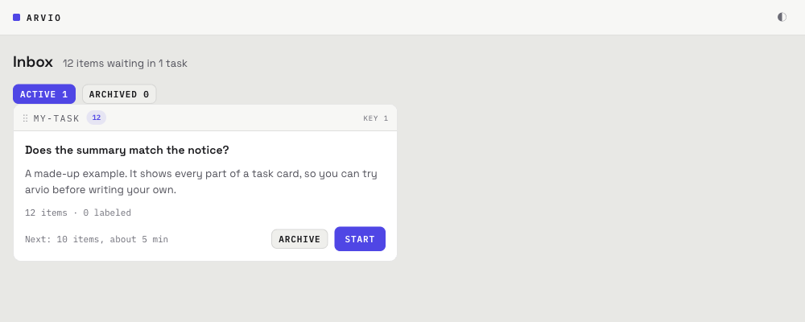
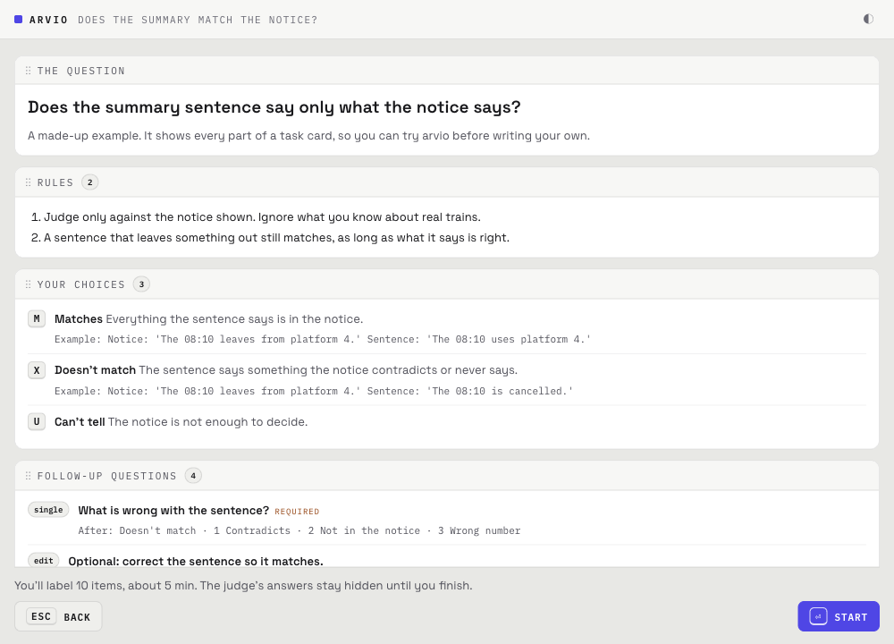
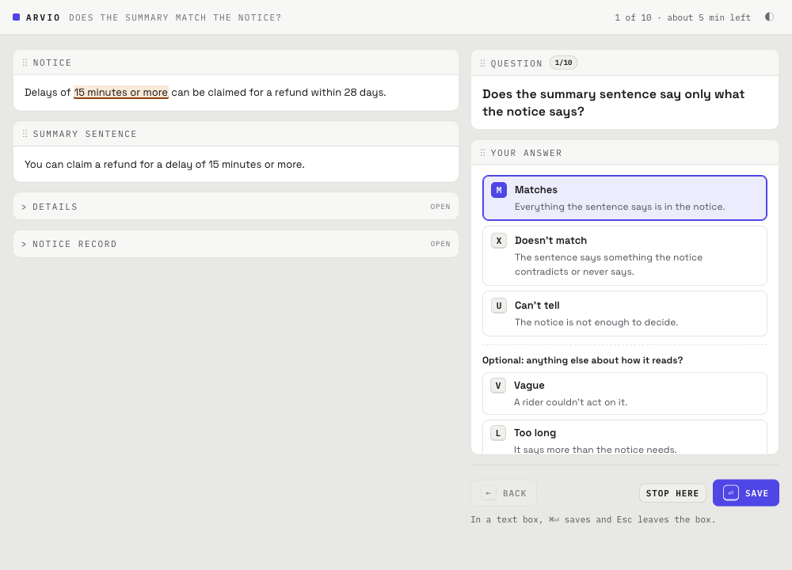
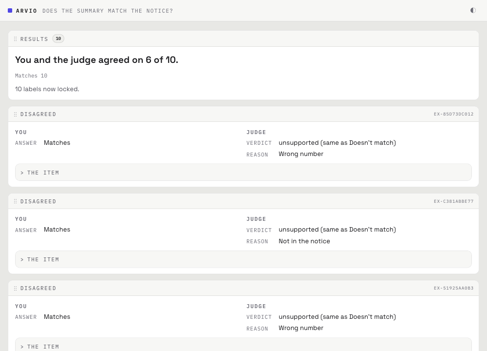
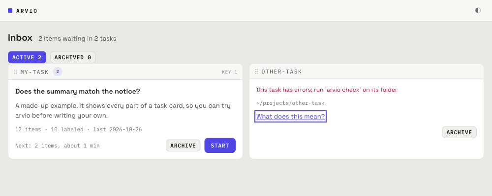

# Add a task to arvio

A **task** is one set of items for you to label, such as one study or one eval run. arvio has no upload button. A task is a folder on your own computer, and you tell arvio about it in your terminal. This guide takes you from a folder to your first label in five steps.

You need macOS or Linux, Python 3.11 or newer, and arvio installed (see the [README](../README.md#use)). Type the commands below in a terminal.

## The five steps

### Step 1: Get a task folder

A task folder holds two files. Your project's export script usually makes them for you. To practice, copy [`examples/hello`](../examples/hello) from this repo to a folder of your own, for example `my-task`.

```
my-task/
  task.toml      the question, the choices and what each choice means
  items.jsonl    the items, one per line
```

arvio adds a third file, `labels.jsonl`, when you save your first label. You don't make it yourself.

### Step 2: Check the folder

```sh
arvio check my-task
```

When the folder is fine, arvio says how many items it found:

```
ok: 12 items, 0 labeled, card version 558d955fbe62
```

When something is wrong, arvio names the file and the line, and stops. See [If something goes wrong](#if-something-goes-wrong).

### Step 3: Add it to your inbox

Your **inbox** is arvio's list of tasks. Pick one of these two commands:

```sh
arvio add my-task             # use the folder where it is
arvio add --import my-task    # use a copy that arvio keeps for you
```

```
added: Does the summary match the notice? (12 waiting)
```

Use `--import` when the folder may change or go away, for example when your project rebuilds it. arvio then keeps its own copy in `~/.arvio/tasks/my-task`, and your labels are saved there.

### Step 4: Open the labeling page

```sh
arvio
```

arvio opens a page in your browser. The task is on it, with how many items are waiting and how long the next session takes. Press `1` or click **Start**.



Keep the terminal open while you label. To stop arvio, press Ctrl-C in that terminal.

### Step 5: Label the items, then finish

First you see the task card: the question, the rules and what each choice means. Read it, then press Enter.



Each item comes up on its own. Press a choice's letter, then Enter to save and move on. ← goes back one item.



After the last item, press Enter to finish. Now arvio shows the judge's answers for the first time: how often you agreed, and each item where you didn't. Your labels are locked from here on.



## Ways to bring a task in

| Way | How | Use it when |
| --- | --- | --- |
| From your project | Your project's export script writes the task folder; then steps 2 to 5. | Your project already has the items and the judge's answers. |
| By hand, or with a small script | Copy `examples/hello` and edit it, or write the files with a script like [`examples/hello/make_items.py`](../examples/hello/make_items.py). | You are trying arvio, or the task is small. |
| File upload | Not supported. | arvio only reads folders on your own computer. |
| From a web address | Not supported. | Same reason: download the files into a folder first. |

### What the files must look like

The full rules are in the [format reference](format.md). These are the ones people meet first:

- Both files are plain text in UTF-8.
- `items.jsonl` has one item per line, each line one JSON object. No line breaks inside an item.
- Each item's `id` has up to 200 characters, made of letters, digits and `. _ : -`, and no two items share one.
- In `task.toml`, `session_size` (items per session) is from 1 to 100, and `seconds_per_item` is from 1 to 3600.
- arvio writes into the folder, so it must be a folder you can change. With `--import`, it writes into its own copy instead.
- A name for `--import --name` has 1 to 64 characters, made of `a-z 0-9 . _ -`, and starts with a letter or digit.

### How big a task can be

arvio sets no limit on file size or on the number of items. On an Apple M1 Max laptop, a task of 10,000 items (a 7.3 MB `items.jsonl`) passed `arvio check` in about half a second, and the page got its inbox data in about 0.4 seconds.

## If something goes wrong

arvio checks the whole folder before it shows anything. When it finds a problem, it names the file and the line, and it shows nothing until you fix it. On the page, a task with a problem says "this task has errors"; run `arvio check` on its folder to see the full message. arvio prints the full path to the file; the examples below shorten it.



These are the three problems people hit most.

### "not valid JSON"

```
my-task/items.jsonl:3: error: not valid JSON: Illegal trailing comma before end of object (column 681)
```

**What it means:** line 3 of `items.jsonl` is not a complete JSON object. The usual causes are a comma after the last value (`"b": 2,}`), an item split over two lines, or a quote missing.

**Fix:** open the file, go to the line and column named, and fix that spot. If your project wrote the file, fix the export script and run it again, so the next export is right too.

### "highlight ... is not in the block's text"

```
my-task/items.jsonl:1: error: display 1 highlight: 'platform  4' is not in the block's text
```

**What it means:** a `highlight` marks a part of a text to show in color, and it must match that text exactly, letter for letter. Here the highlight has two spaces where the text has one. Line breaks and capital letters count too.

**Fix:** copy the phrase straight from the item's text into `highlight`. If your project made the highlight, have it drop any phrase it can't find word for word, so one bad item doesn't block the whole task.

### "another arvio is already running" or "open in another arvio"

```
arvio: another arvio is already running for this inbox; use that page, or stop it with Ctrl-C in its terminal
```

**What it means:** arvio is already running somewhere, maybe in a terminal you forgot. Only one arvio can use an inbox at a time, so that your labels are never saved twice. On the page, a task that another arvio has open says "open in another arvio".

**Fix:** go to the terminal where arvio is running and use its page, or press Ctrl-C there to stop it. Then run `arvio` again.

### Something else

- `missing`: the folder has no `task.toml` or no `items.jsonl`. Check the folder name you typed.
- "the folder is gone; run `arvio remove` on it": you moved or deleted a task folder after adding it. Run `arvio remove` on the old path, then add the folder from its new place.
- Any other message names the file, the line or the setting, and says what it expects. The [format reference](format.md) has every rule.
